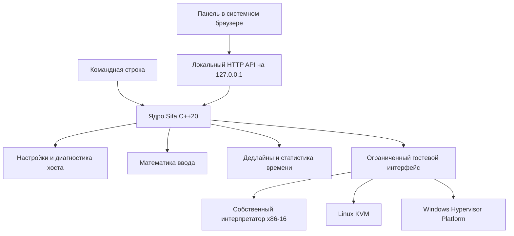

# Архитектура Sifa

Sifa 0.1 — собственное экспериментальное ядро виртуальной машины и локальная
панель управления. Исходный код ядра написан для этого проекта. Проект не
использует BlueStacks, LDPlayer, Nox, QEMU или готовый движок Android-эмулятора.
Он использует системные API виртуализации KVM/WHPX и библиотеку nlohmann/json
для формата настроек. Windows Hypervisor Platform — API операционной системы,
а не движок стороннего эмулятора.

**Эта версия не загружает Android и не запускает Standoff 2.** Она проверяет
основу, необходимую для дальнейшей разработки; результаты мини-гостя не
являются показателями производительности игры.

## Что реализовано

| Компонент | Текущее поведение | Граница реализации |
| --- | --- | --- |
| C++20 executable | Локальная панель, CLI, диагностика и сохранение настроек | UI открывается системным браузером |
| Программное ядро x86-16 | Выполняет ограниченный набор настоящих машинных инструкций | MOV AL/AX/DX, OUT, JMP, NOP, HLT; не универсальный x86 CPU |
| Linux KVM | Создаёт VM, память и vCPU; исполняет встроенный гость | Нужны x86 и доступный `/dev/kvm` |
| Windows WHPX | Создаёт partition/vCPU, отображает RAM, исполняет встроенный гость | Нужны Windows SDK при сборке и активный гипервизор при запуске |
| Настройки ресурсов | Определяет ресурсы хоста, нормализует и сохраняет профиль | Профиль будущей Android VM; RAM/vCPU мини-гостя фиксированы |
| Калибровка мыши | Преобразование относительного смещения в угол без сглаживания | Браузерная лаборатория; доставка ввода в Android отсутствует |
| Планировщик кадров | Монотонные дедлайны, пропуск просроченных кадров без накопления задержки | Графического рендерера пока нет |
| Измерения | Фактические времена тестовых запусков; статистика p50/p95 | Не FPS игры, не input-to-photon latency |



Веб-ресурсы встраиваются в executable при CMake-конфигурации. Установленные
Node.js, Python и отдельный веб-сервер для запуска приложения не требуются.
Браузер может быть закрыт отдельно от локального процесса Sifa.

## Исполнение мини-гостя

Общий `demo_guest_bytes()` содержит один и тот же короткий машинный код для
всех backend: пять пар `MOV AL, byte; OUT 0xe9, AL`, затем `HLT`. Ожидаемый
результат — строка `SIFA\n`, 11 инструкций. Порт `0xe9` служит отладочным каналом
между гостем и хостом; он не связан с физическими устройствами пользователя.

Программный интерпретатор ограничивает код 64 КиБ, вывод 64 КиБ и выполнение
явным бюджетом инструкций. Он проверяет каждый fetch, непосредственные операнды
и относительные переходы, отвергает неизвестные инструкции и порты. Бюджет
защищает от бесконечного цикла; `HLT` является обязательным условием успешного
завершения. Это ограниченная проверяемая модель, а не JIT или Android CPU.

Аппаратные backend принимают **только встроенный фиксированный гость**. Они
не принимают внешние образы, APK или произвольный байткод. KVM возвращает
управление на `OUT`/`HLT`; число выходов ограничено. В WHPX добавлен отдельный
таймер отмены блокирующего запуска vCPU. WHPX API загружаются из системного
каталога Windows; отсутствие API или разрешений сообщает явную ошибку.

Режим `auto` выбирает аппаратный backend после успешной проверки возможности
создать VM. Если гипервизор недоступен, выбирается программное ядро. Ошибка
уже начатого аппаратного запуска возвращается вызывающему коду: она не
маскируется другим результатом.

## Ввод и стабильность времени

Калибровка использует физическую дистанцию:

```text
counts_per_turn = DPI × cm360 / 2.54
angle_degrees   = mouse_counts × 360 / counts_per_turn × sensitivity
```

При множителе `1` параметр `cm360` равен расстоянию на полный оборот. При
другом множителе эффективная дистанция равна `cm360 / sensitivity`. Формула
не зависит от разрешения или частоты кадров. Реальная точность браузерного
теста зависит от доступности Pointer Lock с необработанными движениями,
настроек мыши и реализации браузера. Это необходимо измерять отдельно от
будущего нативного тракта Windows Raw Input → очередь событий → Android.

Планировщик использует `steady_clock` и ожидание до дедлайна. После задержки
он пропускает устаревшие сроки, предотвращая очередь догоняющих кадров.
Здесь нет постоянного активного ожидания, которое расходовало бы CPU слабого
ПК. Для будущего рендерера это только один из элементов управления временем.

## Дальнейшие этапы с критериями готовности

1. **Загрузка гостевой ОС.** Определить ABI x86_64, boot protocol, карту памяти,
   прерывания, таймеры и минимальные virtio-устройства; собрать воспроизводимые
   kernel/initramfs. Критерий: консольный Linux загружается и корректно завершает
   работу на WHPX и KVM. До этого нет оснований считать Android поддержанным.
2. **Android.** Интегрировать собственную сборку AOSP, Binder, файловую систему,
   storage/network/input/audio HAL и гостевые драйверы. Проверять загрузку,
   перезапуск, установку разрешённых APK и стабильность сервисов. AOSP и
   Linux — открытые компоненты гостевой ОС, а не база стороннего эмулятора.
3. **Графика.** Спроектировать гостевой транспорт команд, разделяемую память,
   синхронизацию fences и Vulkan/OpenGL ES backend хоста. Сначала проверять
   корректность изображения и изоляцию памяти, затем копирования и очереди.
   Масштабирование разрешения и фильтрация имеют измеримую стоимость; качество
   и FPS выбираются по результатам конкретного оборудования.
4. **Совместимость ABI.** Установить фактические ABI необходимых приложений.
   Для ARM-only кода требуется самостоятельный переводчик инструкций и
   системных вызовов либо законно доступный совместимый компонент. Реализация
   такого переводчика — отдельный крупный проект; x86-16 demo его не заменяет.
5. **Нативный ввод.** Реализовать Raw Input, предсказуемую очередь событий,
   привязки клавиш к касаниям, захват курсора и освобождение всех нажатий при
   потере фокуса. Критерии: воспроизводимая дистанция на 360°, отсутствие
   залипаний, измеренные перцентили задержки и отсутствие зависимости от FPS.
6. **Standoff 2.** Проверять текущую версию игры на реальных Windows ПК после
   готовности Android, графики, ABI и ввода. Учитывать правила игры и её
   поддержку эмуляторов; проект не реализует обход античита или маскировку
   среды. Успешный запуск других Android-приложений не доказывает совместимость.
7. **Оптимизация.** Сначала измерять CPU/GPU bottleneck, frametime, 1% low,
   память, нагрев и задержку ввода. Сравнивать одинаковые сцены, разрешение,
   настройки и оборудование. Нельзя объявить «лучше в сто раз» или обещать
   игровой FPS без этих сравнений.

Каждый этап требует собственных регрессионных проверок. Наличие интерфейса
или успешно собранного executable не заменяет испытание соответствующей
функциональности.

## Проверки и платформенные ограничения

`vm_tests` выполняет проверки инструкций, ошибок усечённого кода, переходов за
границы, бюджета исполнения, ограничения вывода и результата общего гостя.
Если гипервизор доступен, тот же тест дополнительно проверяет аппаратный
вывод. Недоступный гипервизор явно отмечается как пропущенная проверка,
а не успешный аппаратный запуск.

Тесты настроек, мыши, планировщика и HTTP API выполняются отдельно. Windows
cross-compilation проверяет типы SDK, компоновку и формат PE executable;
она **не проверяет** запуск WHPX, ввод, браузер и игру на Windows. Для аппаратной
валидации требуется машина с включённой виртуализацией. Текущая облачная
машина не предоставляет `/dev/kvm`.
